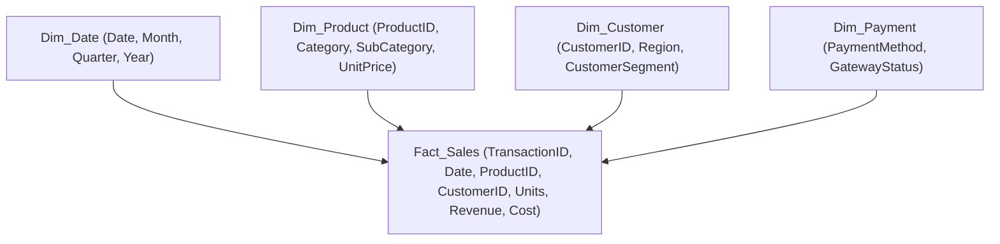

# 📊 Power BI E-Commerce Executive Business Analytics Dashboard

<p align="center">
  
</p>

<p align="center">
  An interactive 5-page enterprise business intelligence dashboard built in <b>Microsoft Power BI Desktop</b> modeling retail sales performance, customer purchasing behavior, regional distribution, and profitability margins using custom DAX measures and Power Query ETL.
</p>

<p align="center">
  <a href="https://github.com/prakruthidevanga/Power-BI-E-Commerce-Business-Analytics-Dashboard-">
    
  </a>
</p>

<p align="center">
  
  
  
  
</p>

---

## 📌 Table of Contents

- [📖 Project Overview](#-project-overview)
- [🎯 Objectives](#-objectives)
- [✨ Key Dashboard Pages](#-key-dashboard-pages)
- [📐 Data Modeling & Star Schema](#-data-modeling--star-schema)
- [🧮 Custom DAX Formulations](#-custom-dax-formulations)
- [🛠️ Technology Stack](#️-technology-stack)
- [📁 Repository Structure](#-repository-structure)
- [⚙️ How to View & Explore](#️-how-to-view--explore)
- [🔮 Future Enhancements](#-future-enhancements)
- [🤝 Contributing](#-contributing)
- [👩‍💻 Author & Accreditations](#-author--accreditations)

---

## 📖 Project Overview

Multi-channel retail enterprises generate millions of transactional rows across products, payment channels, geographic territories, and promotional campaigns. Without consolidated executive business intelligence, leadership cannot pinpoint margin leakage, customer churn, or high-performing product lines.

The **Power BI E-Commerce Executive Business Analytics Dashboard** transforms raw transactional records into an intuitive decision-support ecosystem. Built using **Power Query M language** for ETL and **Data Analysis Expressions (DAX)** for dynamic KPI tracking, the dashboard provides interactive drill-downs across revenue trends, profit realization, and customer lifetime purchasing behaviors.

📊 **Core Mission:** Convert complex enterprise transactional data into actionable executive insights through interactive visual modeling.

---

## 🎯 Objectives

- 📈 **Track Executive KPIs:** Provide instant visibility into Gross Revenue, Total Units Sold, Net Profit Margins, and Average Order Value ($AOV$).
- 🗺️ **Geographic Market Analysis:** Visualize territory performance and regional shipping margins.
- 👥 **Customer Purchasing Dynamics:** Segment consumers by order frequency, transaction sizes, and preferred payment gateways.
- 🛍️ **Product Portfolio Optimization:** Identify top-revenue drivers versus high-margin niche items.
- ⏳ **Time-Intelligence Modeling:** Formulate custom DAX measures for Year-over-Year ($YoY$) and Quarter-over-Quarter ($QoQ$) performance.

---

## ✨ Key Dashboard Pages

### 1. 🏠 Executive Overview & KPI Cockpit
High-level summary cards displaying Total Revenue, Total Margin, Total Orders, and top product categories paired with date range slicers.

### 2. 📈 Sales & Revenue Dynamics
Monthly and quarterly trendlines highlighting seasonality, promotional surges, and year-over-year revenue deviations.

### 3. 🛍️ Product & Category Performance
Decomposition trees and Pareto bar charts showing profit contribution and return rates by merchandise classification.

### 4. 🗺️ Geographic & Logistics Matrix
Map visualizers showing regional order densities, regional shipping delays, and logistics fulfillment benchmarks.

### 5. 👥 Customer Cohort Analysis
Customer segmentation by purchase volume, repeat transaction rates, and preferred checkout methods (Credit Card, Net Banking, UPI, COD).

---

## 📐 Data Modeling & Star Schema



---

## 🧮 Custom DAX Formulations

Representative DAX measures authored to power dashboard KPIs:

- **Total Revenue:**
  $$\text{Total Revenue} = \sum(\text{Sales}[Units] \times \text{Sales}[UnitPrice])$$
- **Gross Profit Margin (%):**
  $$\text{Profit Margin} = \text{DIVIDE}(\text{Total Revenue} - \text{Total Cost}, \text{Total Revenue}, 0)$$
- **Average Order Value (AOV):**
  $$\text{AOV} = \text{DIVIDE}(\text{Total Revenue}, \text{DISTINCTCOUNT}(\text{Sales}[OrderID]), 0)$$

---

## 🛠️ Technology Stack

<p align="center">
  
</p>

| Component | Tool / Technology | Role in Implementation |
| :--- | :--- | :--- |
| **Business Intelligence Platform** | Microsoft Power BI Desktop | Star-schema data modeling, visual layouts, and drill-throughs |
| **ETL & Data Transformation** | Power Query (M Language) | Data type normalization, null value handling, and column pivoting |
| **Calculation Engine** | DAX (Data Analysis Expressions) | Custom time-intelligence measures, KPI cards, and dynamic filters |
| **Presentation Deck** | Microsoft PowerPoint | Executive stakeholder walkthrough and summary deck |

---

## 📁 Repository Structure

```text
Power-BI-E-Commerce-Business-Analytics-Dashboard-/
├── ShopSphere_Dashboard_Presentation (2).pptx   # Executive visual presentation and slide summary
├── README.md                                    # Comprehensive project documentation
└── screenshots/                                 # High-resolution dashboard captures
```

---

## ⚙️ How to View & Explore

1. Install [Microsoft Power BI Desktop](https://powerbi.microsoft.com/desktop/).
2. Clone this repository:
   ```bash
   git clone https://github.com/prakruthidevanga/Power-BI-E-Commerce-Business-Analytics-Dashboard-.git
   cd Power-BI-E-Commerce-Business-Analytics-Dashboard-
   ```
3. Open the `.pbix` dashboard file or view the included executive presentation deck (`ShopSphere_Dashboard_Presentation.pptx`) for an annotated walkthrough of the visualizations!

---

## 🔮 Future Enhancements

- 🔮 **Predictive Demand Forecasting:** Incorporate Power BI built-in ARIMA forecasting for upcoming quarter revenue.
- 📱 **Mobile Layout Optimization:** Design a dedicated vertical mobile layout for smartphone executives.

---

## 🤝 Contributing

Contributions, measure optimizations, and data visualizations are welcomed!

---

## 👩‍💻 Author & Accreditations

**Prakruthi B R**  
*BCA Student specializing in Artificial Intelligence & Machine Learning*  
*Alliance University, Bengaluru (CGPA: 9.60)*  
*GeeksforGeeks Campus Mantri (2026)*

- 💻 **GitHub:** [@prakruthidevanga](https://github.com/prakruthidevanga)
- 🔗 **LinkedIn:** [Prakruthi BR](https://linkedin.com/in/prakruthi-br)
- 🌐 **Portfolio:** [prakruthidevanga.github.io](https://prakruthidevanga.github.io/)
- 📬 **Email:** [prakruthibr2006@gmail.com](mailto:prakruthibr2006@gmail.com)

---

<p align="center">
  <b>📊 Driving enterprise strategy through interactive business intelligence.</b>
</p>

<p align="center">
  
</p>
